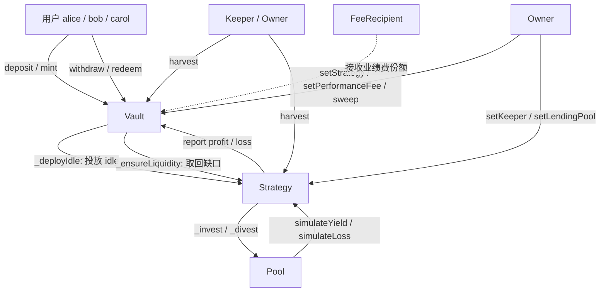

# ERC-4626 收益聚合金库

单策略 ERC-4626 收益聚合器：金库把用户存入的资产按 `totalIdle / totalDebt` 双桶记账后全部投放给一个可插拔策略，策略再把资金投进底层借贷协议吃利息，`harvest()` 结算盈亏、抽取业绩费、把利润按份额摊给持有人。

---

## 架构



资金流：`用户 → Vault（totalIdle）→ Strategy（_invest）→ LendingPool`，反向 `LendingPool → Strategy（_divest）→ Vault（totalIdle）→ 用户`。

---

## 合约清单

| 合约 | 职责 | 关键不变量 |
| --- | --- | --- |
| `src/ERC4626Vault.sol` | 核心金库。份额发行/赎回、双桶记账、策略调度、业绩费铸造、策略切换、误转代币救援 | `totalAssets() == totalIdle + totalDebt`；`totalDebt <= strategy.totalAssets()`；有资产时 `totalSupply() > 0` |
| `src/StrategyBase.sol` | 策略抽象基类。`Ownable + ReentrancyGuard`，定义 `_invest/_divest/_invested/_liquid` 钩子，负责与 vault 的 profit/loss 结算 | `_debt` 只随实际进出调整；`harvest` 上报的 profit 不超过实际可动用的流动性 |
| `src/strategies/LendingStrategy.sol` | 具体策略，把资金存入 `ILendingPool`，提供 `estimatedAPY()` 展示 | `totalAssets() == 现金 + 池内头寸`；`availableLiquidity() <= totalAssets()` |
| `src/interfaces/IStrategy.sol` | 策略接口（含 `availableLiquidity`） | — |
| `src/interfaces/IVault.sol` | 扩展 `IERC4626` 的金库接口（`setStrategy` / `report` / `totalDebt` / `totalIdle` …） | — |
| `src/interfaces/ILendingPool.sol` | 借贷池最小接口 | — |
| `src/mocks/MockERC20.sol` | 可 mint/burn、可配置 decimals 的测试代币 | — |
| `src/mocks/MockLendingPool.sol` | 借贷池测试替身，支持 `simulateYield` / `simulateLoss` / `simulateIlliquidity` | 头寸总和与现金保持一致（除刻意模拟的坏账/挤兑） |
| `script/Deploy.s.sol` | 一键部署全套栈并写出 `deployments/<chainid>.json` | — |

---

## 快速开始

```bash
git clone --recursive https://github.com/stayawaycc/erc4626-vault.git
cd erc4626-vault

forge build
forge test
forge coverage --report summary --ir-minimum

# 本地部署（需先起 anvil）
anvil
forge script script/Deploy.s.sol --rpc-url local --broadcast
```

或者一条命令起全套（合约 + 前端）：

```bash
npm install
npm run dev:all
```

`lib/forge-std`（v1.17.0）与 `lib/openzeppelin-contracts`（v5.1.0）以 submodule 形式提交，`--recursive` 克隆后可直接构建，无需额外安装步骤。

工具链：`forge 1.6.0-nightly`，`solc 0.8.28`，`evm_version = "cancun"`，`via_ir = true`，`optimizer_runs = 200`。

### 本地部署验证

已在 `anvil` 上真实广播部署并跑通完整资金流（非 dry run）：

```bash
anvil
forge script script/Deploy.s.sol --rpc-url local --broadcast
```

链上地址（chainId 31337，由 `script/Deploy.s.sol` 生成并写入 `deployments/31337.json`）：

| 合约 | 地址 |
| --- | --- |
| asset (MockERC20) | `0x5FbDB2315678afecb367f032d93F642f64180aa3` |
| lendingPool | `0xe7f1725E7734CE288F8367e1Bb143E90bb3F0512` |
| strategy | `0xCf7Ed3AccA5a467e9e704C703E8D87F634fB0Fc9` |
| vault | `0x9fE46736679d2D9a65F0992F2272dE9f3c7fa6e0` |

部署后状态核对：`totalAssets = 1e22`、`totalIdle = 0`、`totalDebt = 1e22`、`strategy` 已挂载、`decimals = 18`、`performanceFee = 1000`、`convertToAssets(1e18) = 999999999999999`。

端到端链路实测（`cast send` 逐笔，全部 `status 1`）：

| 步骤 | 交易 | 结果 |
| --- | --- | --- |
| 池内注入 500 mUSD 模拟利息 | `simulateYield(500e18)` | 策略 `totalAssets` 1e22 → 1.05e22，金库 `totalDebt` 仍为 1e22（差额即待上报收益） |
| 结算收益 | `harvest()` | `lastProfit = 500e18`，`totalAssets` 1e22 → 1.05e22，`convertToAssets(1e18)` 0.000999999999 → 0.001044999999 |
| 赎回 1,004,784.68… 份额 | `redeem(...)` | 资产余额 9.9e23 → 9.91045e23，净增 1.045e20，与份额价值精确吻合 |

---

## 前端

`frontend/` 是一个 Vite + React 18 + wagmi v2 + viem 的单页 dApp，三个标签页：

| 标签 | 内容 |
| --- | --- |
| 金库 | 存入/赎回（实时 `previewDeposit` / `previewRedeem`）、金库总览（双桶记账、份额价格、利用率、绩效费）、策略与收益（注入利息 + `harvest`） |
| 安全实验 | 通胀攻击实验台：实时显示虚拟份额偏移、死份额、把份额压到 0 的成本，并提供「直接转账捐赠」按钮做对照实验 |
| 开发工具 | 测试资产水龙头、合约地址表（点击复制） |

```bash
npm install
npm run dev:all      # anvil:8546 → deploy → vite:5174
```

单独运行：`npm run dev:anvil` / `npm run dev:deploy` / `npm run dev`。

端口 8546 是刻意的：它与 `amm-dex` 项目的 8545 分开，两个前端可以同时运行。

前端构建：`npm run build` → 409.72 kB（gzip 125.06 kB），`npm run typecheck` 零错误。

> **Windows 注意**：若系统配置了 HTTP 代理，运行任何 `forge` / `cast` 命令前需设置
> `NO_PROXY=127.0.0.1,localhost`，否则代理会拦截本地 RPC 并返回 502。`npm run dev:all`
> 已在脚本内部设置该变量。


---

## 测试结果

一条命令 `forge test` 的真实输出：

```
Ran 3 test suites in 2.26s: 86 tests passed, 0 failed, 0 skipped (86 total tests)
```

| 套件 | 用例数 | 结果 |
| --- | --- | --- |
| `test/ERC4626Vault.t.sol` | 55 | 全部通过（含 3 个 fuzz，每个 512 runs） |
| `test/Strategy.t.sol` | 27 | 全部通过 |
| `test/Invariant.t.sol` | 4 | 全部通过（每个 128 runs × 4096 calls，0 reverts） |
| **合计** | **86** | **100% 通过** |

不变量测试的不变量清单：

| 不变量 | 断言 |
| --- | --- |
| `invariant_TotalAssetsEqualsIdlePlusDebt` | 任何时候 `totalAssets() == totalIdle + totalDebt` |
| `invariant_VaultNeverInsolvent` | `totalAssets() >= totalDebt`，且 `totalDebt <= strategy.totalAssets()` |
| `invariant_SharesNeverWorthLessThanDeposited` | 无模拟亏损时，全部在外流通份额可兑换的资产 ≥ handler 记录的净本金 |
| `invariant_SupplyNeverZeroWithAssets` | 金库持有资产时 `totalSupply() > 0` |

`VaultHandler` 暴露的动作：`deposit` / `mint` / `withdraw` / `redeem` / `harvest` / `simulateYield` / `simulateLoss` / `warp`，actor 限定为 alice/bob/carol 三人，每个动作内部 `bound` 参数并 try/catch 掉合法 revert，因此 4096 次调用中 0 revert，全部是有效状态转移。

---

## 测试覆盖率

`forge coverage --report summary --ir-minimum` 真实输出：

| File | % Lines | % Statements | % Branches | % Funcs |
| --- | --- | --- | --- | --- |
| `src/ERC4626Vault.sol` | 91.52% (151/165) | 88.63% (187/211) | 69.70% (23/33) | 100.00% (30/30) |
| `src/StrategyBase.sol` | 94.81% (73/77) | 92.78% (90/97) | 83.33% (15/18) | 100.00% (13/13) |
| `src/strategies/LendingStrategy.sol` | 97.62% (41/42) | 90.77% (59/65) | 50.00% (5/10) | 100.00% (6/6) |
| `src/mocks/MockERC20.sol` | 100.00% (9/9) | 83.33% (5/6) | 0.00% (0/1) | 100.00% (4/4) |
| `src/mocks/MockLendingPool.sol` | 100.00% (48/48) | 80.36% (45/56) | 15.38% (2/13) | 100.00% (7/7) |
| `test/BaseTest.sol` | 100.00% (29/29) | 100.00% (26/26) | 100.00% (0/0) | 100.00% (5/5) |
| `test/Invariant.t.sol` | 86.15% (56/65) | 87.14% (61/70) | 83.33% (10/12) | 83.33% (10/12) |
| `script/Deploy.s.sol` | 0.00% (0/47) | 0.00% (0/53) | 0.00% (0/2) | 0.00% (0/2) |
| **Total** | **84.44% (407/482)** | **80.99% (473/584)** | **61.80% (55/89)** | **94.94% (75/79)** |

核心合约（`src/` 下非 mock）行覆盖率：**93.3%（265/284）**，函数覆盖率 **100%（49/49）**。
`Deploy.s.sol` 不计入单测覆盖，它由 `forge script` 的 dry run 与真实广播验证（广播 gas：6,576,753）。

未覆盖的行集中在两类：`require` 守卫的不可达分支（例如 `_decimalsOffset` 与 asset 小数位组合下的溢出保护），以及 `sweep` 的异常路径。这些分支靠人工审查而非测试覆盖来保证，README 的「已知取舍」章节对此有说明。

---

## Gas 报告

`forge test --gas-report` 关键数字（单位：gas）：

### ERC4626Vault（部署成本 2,123,547 / 部署体积 10,364 bytes）

| 函数 | Min | Avg | Median | Max |
| --- | --- | --- | --- | --- |
| `deposit` | 27,229 | 222,303 | 201,420 | 303,040 |
| `mint` | 158,568 | 194,933 | 186,004 | 301,256 |
| `withdraw` | 61,993 | 134,802 | 145,916 | 159,654 |
| `redeem` | 28,051 | 130,442 | 145,888 | 159,655 |
| `harvest` | 23,631 | 153,416 | 160,176 | 253,991 |
| `report` | 24,205 | 24,205 | 24,205 | 24,205 |
| `setStrategy` | 23,801 | 65,726 | 63,814 | 282,112 |
| `sweep` | 28,939 | 40,119 | 34,387 | 57,031 |
| `totalAssets` | 4,434 | 4,434 | 4,434 | 4,434 |
| `maxDeposit` | 6,913 | 6,941 | 6,941 | 6,969 |
| `maxWithdraw` | 31,776 | 31,776 | 31,776 | 31,780 |
| `maxRedeem` | 31,840 | 31,840 | 31,840 | 31,840 |
| `availableLiquidity` | 26,215 | 26,215 | 26,215 | 26,215 |

### LendingStrategy（部署成本 1,245,256 / 部署体积 5,803 bytes）

| 函数 | Min | Avg | Median | Max |
| --- | --- | --- | --- | --- |
| `deposit` | 23,892 | 46,725 | 26,740 | 89,544 |
| `withdraw` | 21,866 | 47,322 | 42,443 | 90,421 |
| `harvest` | 25,686 | 136,314 | 94,838 | 249,235 |
| `setLendingPool` | 23,876 | 47,320 | 47,771 | 47,771 |
| `setKeeper` | 23,788 | 26,116 | 23,988 | 30,572 |
| `estimatedAPY` | 6,873 | 7,020 | 7,020 | 7,167 |
| `availableLiquidity` | 7,968 | 14,772 | 13,755 | 16,255 |
| `totalAssets` | 7,861 | 12,630 | 13,160 | 13,160 |

### Mock 合约

| 合约 | 部署成本 | 部署体积 |
| --- | --- | --- |
| `MockERC20` | 532,852 | 3,099 bytes |
| `MockLendingPool` | 537,945 | 2,457 bytes |

`deposit` 的 222k 均值里包含"补足 idle + 投放策略"的两次外部调用；纯 vault 记账部分约 27k（Min 值，即资金已在策略内、只增发份额的场景）。

---

## 安全设计

### 1. 通胀攻击（Inflation / Donation Attack）

#### 攻击原理

朴素 ERC-4626 金库用 `sharePrice = totalAssets / totalSupply` 定价，第一笔存款时 `totalSupply` 从 0 变成 `1 wei` 份额、`totalAssets` 变成 `1 wei` 资产。攻击者可以：

1. 自己先存 **1 wei**，拿到 **1 份份额**（占总量 100%）；
2. 直接向金库地址 **转账捐赠 10,000e18**（`donation`）。这一笔不走 `deposit`，不增发份额，但抬高了 `totalAssets`，于是 1 份份额的价格瞬间变成 10,000e18；
3. 受害者按 `previewDeposit` 存入 **10,000e18**，`shares = assets * totalSupply / totalAssets` 向下取整 → `10000e18 * 1 / 10001e18 = 0`，**受害者拿到 0 份额**；
4. 攻击者赎回那 1 份份额，拿走约 20,000e18，净赚受害者本金。

本质是**份额单价被外部转账单方面操纵 + 向下取整把不足 1 份的存款抹成 0**。ERC-4626 规范原文也明确警告了这一点。

#### 本项目的双重防御

**第一层：`_decimalsOffset()` 虚拟份额**

```solidity
function _decimalsOffset() internal pure override returns (uint8) {
    return DECIMALS_OFFSET; // 3
}
```

OZ 5.x 的换算公式是：

```
shares = assets * (totalSupply + 10**offset) / (totalAssets + 1)
```

offset = 3 注入了 **1000 份虚拟份额** 和 **1 单位虚拟资产**。这让第一笔存款的初始汇率变成 `1 资产 : 1000 份额` 而不是 `1:1`，即攻击者必须把单价推到 `> 1000 wei/share` 才可能让受害者的份额取整成 0。虚拟份额的价值不属于任何人，等于攻击者的捐赠有一部分被"烧"进了虚拟池。

**第二层：`DEAD_SHARES` 死份额**

```solidity
uint256 public constant DEAD_SHARES = 1e3;
address public constant DEAD_ADDRESS = address(0xdEaD);

function _mintDeadSharesAfter(bool wasEmpty) internal {
    if (wasEmpty) _mint(DEAD_ADDRESS, DEAD_SHARES);
}
```

首笔存款完成后立刻向 `0xdEaD` 铸造 1000 份永久锁定的份额。攻击者再也无法成为"唯一持有人"，他捐赠的价值会被死份额按比例分走一部分，永远无法取回。

两层的组合效果：攻击者要把单价推到能让 1e18 存款取整为 0，需要捐赠约 `victimDeposit * (1000 虚拟 + 1000 死份额 + 1000 攻击者份额) ≈ 3000 倍`受害者本金，而他最多只能拿走受害者那一份本金 —— **收益成本比约 1:3000，攻击在经济上彻底不成立**。

#### 测试如何验证

`test/InflationAttackIsUnprofitable`（核心安全测试，注释里写清了完整攻击链路）：

```
攻击者存 1 wei → 捐赠 10_000e18 → 受害者存 10_000e18
断言：victimShares > 0（受害者份额不为 0）
断言：受害者损失 < 1%（lossBps < 100）
断言：attackerOut < 攻击者总投入（攻击者亏钱）
```

`test_GriefingAttackCostsFarMoreThanItSteals` 覆盖"恶意烧钱让受害者份额归零"的极端变种：只有在捐赠达到 `3000 × victimDeposit` 时受害者份额才会变成 0，此时断言 `攻击者亏损 > 受害者亏损`。

`test_RealisticDonationCannotDiluteVictim` 覆盖现实量级（捐赠额与受害者本金同数量级）：受害者保留 > 99.9%。

`test_DonationIsAbsorbedIntoIdle` 验证捐赠本身的行为：捐赠不会在 view 层偷偷重定价（`totalAssets` 仍读旧值），但在下一次状态变更时被同步进 `totalIdle` 并归属于现有持有人 —— 这是设计意图，不是漏洞。

### 2. 双桶记账，不用 `balanceOf` 定价

`totalAssets()` 恒等于 `totalIdle + totalDebt`，两个桶只在真实资金进出时变动：

```solidity
function totalAssets() public view override returns (uint256) {
    return totalIdle + totalDebt;
}
```

好处是任何"直接转账进合约"都不会在交易中途改变份额价格，配合 `_syncIdle()` 在每次状态变更入口显式对齐真实余额，捐赠被显式吸收而不是被隐式利用。

### 3. 舍入方向严格对齐 ERC-4626

- `previewDeposit` / `previewMint` / `convertToShares` 向下取整（对用户不利，对金库有利）
- `previewWithdraw` / `previewRedeem` / `convertToAssets` 向上/向下按规范
- 业绩费份额用闭式解精确计算，保证铸出的份额价值恰好等于 `profit * fee / 10000`：

```solidity
// x * (A + 1) / (S + 10**offset + x) == F  =>  x = F * (S + 10**offset) / (A + 1 - F)
function _sharesForFee(uint256 feeAssets) internal view returns (uint256) {
    uint256 supply = totalSupply() + 10 ** DECIMALS_OFFSET;
    uint256 assetsAfter = totalAssets() + 1;
    if (feeAssets >= assetsAfter) return 0;
    return feeAssets.mulDiv(supply, assetsAfter - feeAssets, Math.Rounding.Floor);
}
```

### 4. 流动性诚实上报

`maxWithdraw` / `maxRedeem` 不再直接返回名义债务，而是走 `_availableLiquidity()`，后者调用 `strategy.availableLiquidity()`，在借贷池现金不足时如实下降。测试 `test_MaxWithdrawReflectsStrategyLiquidity` 验证：池子被抽走 400e18 现金后，`maxWithdraw` 从 1000e18 降到 600e18。

### 5. 部分成交容忍

`StrategyBase.withdraw` 从不假设 `_divest` 能全额成交：

```solidity
uint256 available = IERC20(asset).balanceOf(address(this));
if (available < assets) {
    uint256 toDivest = assets - available;
    uint256 before = available;
    _divest(toDivest);                                   // 可能只拿回一部分
    available += IERC20(asset).balanceOf(address(this)) - before;
}
uint256 received = assets < available ? assets : available;
if (received == 0) revert Strategy__NothingToDivest(assets, received);
_debt = _debt > received ? _debt - received : 0;         // 债务只按实际到账扣减
```

`harvest` 同样把 profit 上限压到实际可动用的流动性，未实现部分留在策略里等下次 harvest，杜绝重复计息。

### 6. 策略切换的原子清债

`setStrategy` 强制先全额 divest，`totalDebt != 0` 时直接 revert `Vault__DebtNotCleared`，避免旧策略里残留资产变成孤儿资金。同时校验新策略的 `asset()` 必须与金库一致（`Vault__AssetMismatch`）。

### 7. 权限与参数边界

| 操作 | 权限 | 校验 |
| --- | --- | --- |
| `setStrategy` | owner | 非零地址、不得与当前相同、asset 必须一致、必须先清债 |
| `setPerformanceFee` | owner | `<= 2000`（20% 硬上限） |
| `setFeeRecipient` | owner | 非零地址 |
| `setDepositLimit` | owner | 不得低于当前 `totalAssets()` |
| `setMaxReportDelay` | owner | 非零 |
| `sweep` | owner | 不得是 asset 本身、余额非零 |
| `report` | 仅 strategy | `msg.sender == strategy` |
| `strategy.deposit` | vault / keeper | — |
| `strategy.withdraw` | 仅 vault | — |
| `strategy.harvest` | keeper / owner / vault | — |

### 8. 重入防护

`ERC4626Vault` 与 `StrategyBase` 均继承 `ReentrancyGuard`，所有资金出入口加 `nonReentrant`。`harvest` 在 vault 层不加 guard，因为它只是转发给策略、由策略侧统一守卫，避免同一 guard 在调用链上自我冲突。

---

## 目录结构

```
erc4626-vault/
├── foundry.toml                    # solc 0.8.28 / cancun / via_ir / fuzz+invariant 配置
├── .gitignore                      # 排除 out, cache, broadcast, deployments/*.json, .env；保留 lib/
├── README.md
├── deployments/
│   ├── .gitkeep
│   └── 31337.json                  # forge script 生成（已 gitignore）
├── script/
│   └── Deploy.s.sol                # 全套栈部署 + vm.writeJson
├── src/
│   ├── ERC4626Vault.sol            # 核心金库
│   ├── StrategyBase.sol            # 策略抽象基类
│   ├── interfaces/
│   │   ├── IStrategy.sol
│   │   ├── IVault.sol
│   │   └── ILendingPool.sol
│   ├── strategies/
│   │   └── LendingStrategy.sol     # 借贷策略
│   └── mocks/
│       ├── MockERC20.sol
│       └── MockLendingPool.sol
├── test/
│   ├── BaseTest.sol                # 共享 fixture
│   ├── ERC4626Vault.t.sol          # 55 个用例
│   ├── Strategy.t.sol              # 27 个用例
│   └── Invariant.t.sol             # 4 个不变量 + VaultHandler
└── lib/
    ├── forge-std/                  # v1.17.0（submodule）
    └── openzeppelin-contracts/     # v5.1.0（submodule）
```

---

## 已知取舍

1. **`decimals()` 返回 asset 的 decimals**，而份额记账精度实际是 `assetDecimals + 3`（虚拟份额）。这是为了让钱包/UI 显示直观；代价是链下工具用 `decimals()` 反算份额价值时会有 3 位精度偏差，应以 `convertToAssets()` 为准。
2. **`estimatedAPY()` 是展示用粗略值**：单次观测窗口、不复利、直接用最近一次 harvest 的 profit 年化。真实 APY 需要多期数据。
3. **首笔存款的份额数比 `previewDeposit` 少 `DEAD_SHARES` 比例**（1e18 存款约损失 1e-18 比例）。这是死份额的必然成本，量级为 dust。
4. **单策略**：同一时间只能挂一个策略，切换需清债。多策略分散需要改成 `Strategy[] + 权重分配`。
5. **`report()` 信任策略上报的 loss**：策略是 owner 注册的可信合约，但若策略被攻破可恶意上报巨额 loss 稀释持有人。生产环境应加 timelock + loss 上限熔断。
